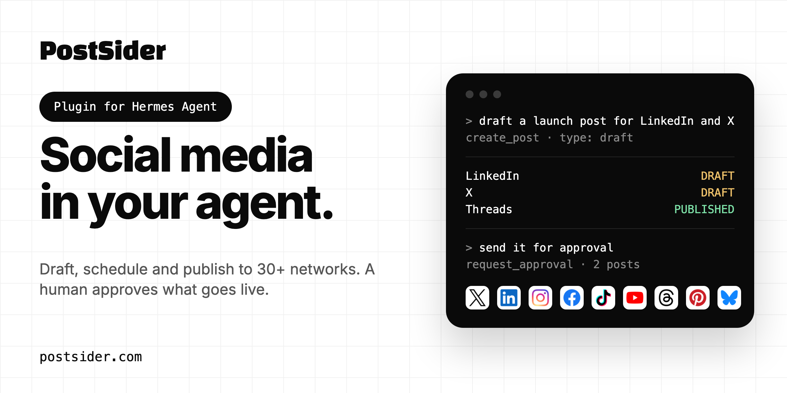

# PostSider plugin for Hermes Agent, OpenClaw and Claude



Your own social media calendar inside [Hermes Agent](https://github.com/NousResearch/hermes-agent) or
[OpenClaw](https://github.com/openclaw/openclaw) or Claude, through the hosted
[PostSider](https://postsider.com) MCP server. Plan, draft, schedule, publish and review posts on 30+ networks, and let a human approve what
goes live. OpenClaw users: see [OpenClaw](#openclaw) below. Claude users: see [Claude Code](#claude-code).

Ask things like:

- "Draft a LinkedIn and X post about our release and put it in the next free slot."
- "What is scheduled for the next 14 days? Which posts failed, and why?"
- "Attach this image to the draft and send it for approval."
- "How did last month's posts perform on Instagram?"
- "Give me the morning check: errors, stuck posts, channels that need a reconnect."

## What is in this package

This is an [Agent Plugins v1](https://agent-plugins.org) package with configuration only, no code:

- `plugin.json`: the manifest. It marks the server `untrusted`, so Hermes asks before every tool the
  server does not mark read-only.
- `mcp.json`: one MCP server, `postsider`, that runs the pinned
  [`mcp-remote@0.15.2`](https://www.npmjs.com/package/mcp-remote) through `npx` and connects it to
  `https://mcp.postsider.com/mcp` with OAuth sign-in.
- `skills/postsider/SKILL.md`: how to use the tools well (draft first, read back every write, confirm
  before anything public or permanent).
- `.claude-plugin/plugin.json` and `.mcp.json`: the same plugin and server in the Claude plugin
  layout, which ClawHub and OpenClaw read.
- `claude/`: the plugin for Claude (claude.ai, Cowork and Claude Code). It connects to the remote server
  directly over HTTP with Claude's own OAuth, so it needs no Node.js.
  `.claude-plugin/marketplace.json` makes this repository a Claude Code marketplace that lists it.

## Install

```bash
hermes plugins install postsider --enable
```

Or straight from this repository:

```bash
hermes plugins install https://github.com/lumizone/postsider-agent-plugin.git --enable
```

Requirements: Hermes Agent 0.21.6 or newer, Node.js 20.18.1 or newer with `npx` on the `PATH`, and a
PostSider account (7-day trial, no credit card: https://app.postsider.com/register).

## Sign in

The first time Hermes connects to the server, `mcp-remote` opens your browser on the PostSider sign-in
page. Sign in and approve the requested access (read posts, write posts, manage channels). The channels
you connected in PostSider are the ones the agent can see.

Hermes waits about a minute for a new MCP connection. If you need longer to sign in (a new account,
two-factor authentication), the attempt is dropped and the next use opens the sign-in page again.
Creating the account first at https://app.postsider.com/register avoids that, and so does letting Hermes
run the sign-in itself. Hermes's own OAuth client then replaces this package's `mcp-remote` server, and
the skill keeps working:

```bash
hermes mcp add postsider --url https://mcp.postsider.com/mcp --auth oauth
```

On a headless machine, use an organization API key in a header instead (an entry in `config.yaml`
replaces this package's server). Create the key in PostSider under Settings, then API:

```yaml
# ~/.hermes/config.yaml
mcp_servers:
  postsider:
    url: "https://mcp.postsider.com/mcp"
    headers:
      Authorization: "Bearer <your PostSider token>"
```

## Claude Code

```bash
claude plugin install postsider --marketplace lumizone/postsider-agent-plugin
```

Or inside a session: `/plugin install postsider --marketplace lumizone/postsider-agent-plugin`. Then
run `/mcp`, choose `plugin:postsider:postsider` and sign in to PostSider. Details:
[claude/README.md](claude/README.md).

## OpenClaw

OpenClaw reads this package as a Claude-layout bundle: it loads the `postsider` skill and the
`postsider` MCP server from `.mcp.json`.

```bash
openclaw plugins install clawhub:postsider
```

OpenClaw gives a new MCP connection about 30 seconds and a tool call 60 seconds by default. The
browser sign-in through `mcp-remote` has to fit in the first window, and a slow call such as a large
media upload can run longer than the second. For everyday use, let OpenClaw run the sign-in itself with
a longer call timeout. A server you add yourself replaces the package's server of the same name, and the
skill keeps working:

```bash
openclaw mcp set postsider '{"url":"https://mcp.postsider.com/mcp","transport":"streamable-http","auth":"oauth","requestTimeoutMs":180000}'
```

```bash
openclaw mcp login postsider
```

`login` prints a link; open it, sign in to PostSider and allow access. On a machine without a browser,
open the link elsewhere and finish with `openclaw mcp login postsider --code <code>`.

**OpenClaw does not ask before write tools.** It does not read the `untrusted` marker in `plugin.json`,
so nothing in OpenClaw stops the agent from calling `postsider_create_post` with type `now`, which
publishes to your public social accounts immediately, or from deleting posts and media. The bundled
skill tells the agent to default to drafts, to show the exact text, channels and timing first, and to
confirm before anything public or permanent, but that is an instruction to the model, not a gate. If you
want a hard limit, use PostSider's own review controls (the approval flow, available from the Team plan) and do
not run the agent unattended against channels you are not ready to post to. `postsider_pause_publishing` stops all publishing for the organization if
something goes wrong, and only a person can resume it in the dashboard.

## Plans

PostSider starts with a 7-day trial and no credit card. Paid plans start at $20 a month per organization
and include MCP, API and webhook access on every tier. Details: https://postsider.com/pricing/

## Disclosure

- **Network:** every tool call goes to PostSider's hosted server (`mcp.postsider.com`), which acts on the
  user's own PostSider workspace and, when posts go out, calls the connected social networks with the
  channel connections the user made in PostSider. Tool arguments and results, including post text and
  media, are handled by PostSider as part of the user's account. See the privacy policy below.
- **Remote tool set:** the tools are served by that server at runtime. The pinned commit of this
  package covers the configuration and skill only, not the server's code, and the server can add or
  change tools.
- **Writes and external effects:** the server can create, edit, schedule and delete posts, and a post
  created with type `now` or `schedule` is published to public social media accounts. It can also upload
  and delete media, change channel settings and posting slots, connect or disconnect channels, pause
  publishing for the whole organization, and run PostSider's AI checker and caption rewrite. The package
  marks the server `untrusted`, so Hermes asks before each tool the server does not annotate as read-only
  and refuses those tools in unattended runs such as cron jobs. The bundled skill tells the agent to
  default to drafts and to confirm exact text, channels and timing before anything goes live.
- **Usage limits and cost:** actions count toward the user's PostSider plan (posts per month, channels
  and a monthly allowance for the AI checker and caption rewrite).
- **Local process and credentials:** `npx` downloads and runs `mcp-remote@0.15.2` from npm. On first
  use it starts a local callback server on a localhost port, opens the browser, and stores the OAuth
  tokens for PostSider under `~/.mcp-auth`. Without a stored token, an unattended run fails when
  Hermes's connect timeout expires (about a minute) instead of hanging.
- **No telemetry** from this package, no bundled credentials, no background processes beyond the MCP
  server process Hermes starts, no self-updater.

Privacy policy: https://postsider.com/privacy/ · Terms: https://postsider.com/terms/ ·
Contact: lukasz@postsider.com

## License

MIT for the contents of this repository. PostSider itself is a hosted service.
